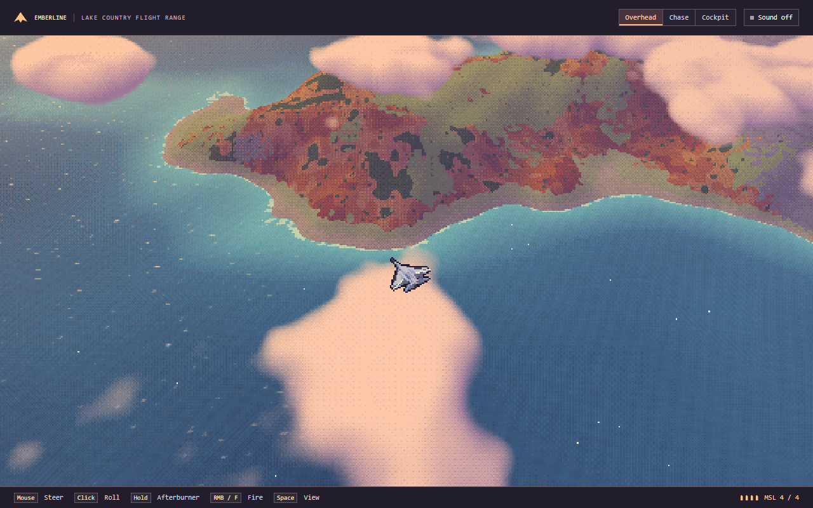
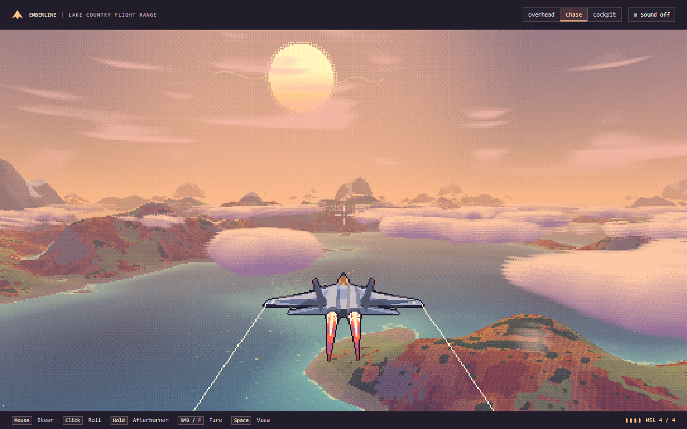
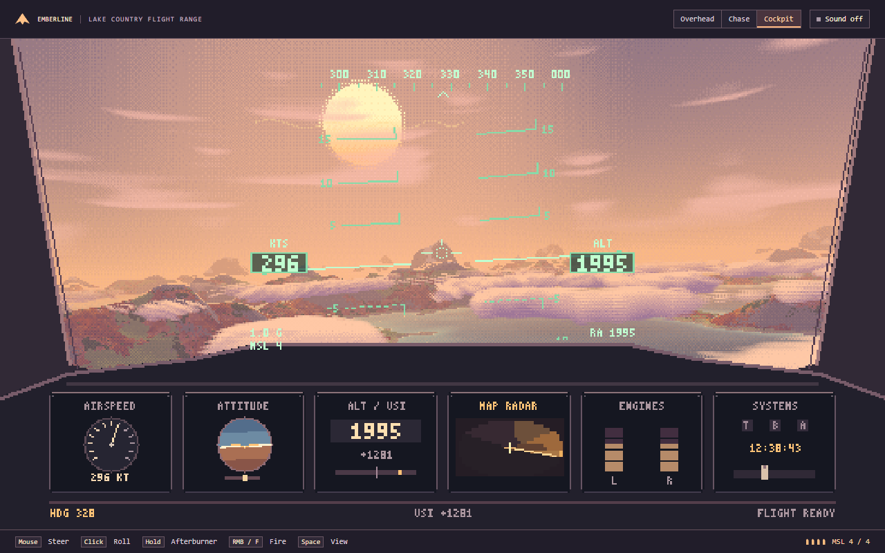
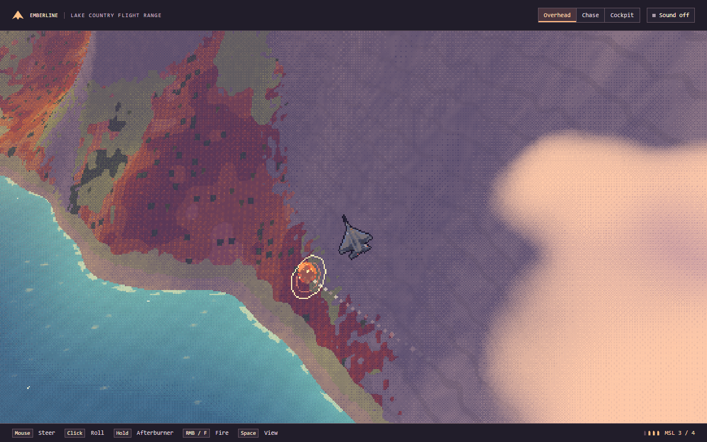
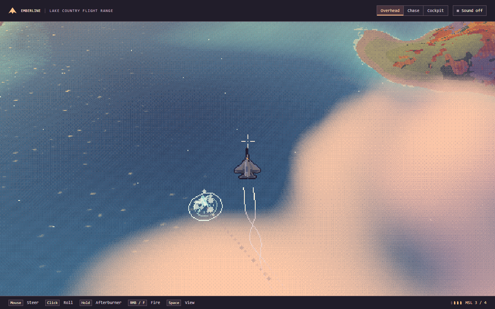

# EMBERLINE

**[Play EMBERLINE on GitHub Pages](https://dtywong.github.io/emberline/)**

Fly an original twin-engine, twin-tail jet over an autumn lake district at sunset. Skim the water, climb through clouds, or open the throttle and follow the sun. The entire game runs from a single HTML file using WebGL2 and Canvas 2D.

## Controls

Click **Take Flight** or press **Enter** to start. The jet flies a gentle patrol until you take control and automatically pulls up to avoid terrain.

| Action | Mouse and keyboard | Touch |
| --- | --- | --- |
| Steer | Move the mouse. In Overhead, the jet turns toward the pointer. In Chase and Cockpit, move away from the center to turn, climb, or dive. | Drag on the flight view. |
| Barrel roll | Click the left mouse button. | Tap **Roll**. |
| Afterburner | Hold the left mouse button. | Hold **Boost**. |
| Fire a missile | Right-click or press **F**. | Tap **Fire**. |
| Change view | Press **Space** to cycle through all three views, or select one in the top bar. | Select a view in the top bar. |
| Toggle sound | Click **Sound** or press **M**. | Tap **Sound**. |

You can fire while holding the afterburner. The jet carries four missiles, and each rail reloads a few seconds after firing. Sound is off by default.

## Screenshots

### Overhead

### Chase

### Cockpit

### Missile impacts

